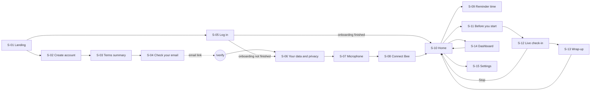

# Screens

Screen inventory for the four journeys in `journey-map.md`. Each screen lists the journey stages it serves, what it contains, every state it must handle, where it goes next, and how to tell it's done. Routes are suggestions; keep them if the project has no convention of its own.

Copy in quotes is a starting point that already follows `content-and-guardrails.md`. Adapt the wording, but keep the meaning and never break a guardrail.

## Navigation map



## Shared components

**Recording indicator.** A persistent, unmissable marker shown whenever the mic is live: during a check-in, and at all times while day capture is on (FL-3 guardrail). It shows a dot plus a text label ("Listening" or "Day capture on"), never colour alone. During day capture, tapping it opens a control to pause capture for 1 hour or turn it off. Announce state changes to screen readers through a polite live region.

**Voice session panel.** The main element of S-12. It shows one large visual for the current state (preparing, agent speaking, listening, saving), captions for everything the agent says, a Stop button that is always visible, and an "I've finished" button while listening. With reduced motion, it uses a static visual instead of an animation.

**Stop button.** Visible throughout every check-in state (CI-2 guardrail). One tap opens an in-page confirmation, "End this check-in? Nothing from today's check-in will be saved.", with "End check-in" and "Keep going". Never use a browser `confirm()`.

**Onboarding progress.** "Step 2 of 3" text plus a simple bar on S-06 to S-08. Back is always available. Progress is saved after each step, so the person resumes where they left off (FL-1).

---

## Flow 1: Sign-up

### S-01 Landing · `/`
Stages: SU-1, SU-2

- **Purpose:** explain plainly what the app does and who it's for, then offer Sign up and Log in.
- **Content:**
  - A hero with a one-line promise, e.g. "A two-minute daily chat about your day, and a simple way to see how your memory for everyday things is doing over time."
  - How it works, in three steps: talk about yesterday, the app compares it with what was captured, you see your own trend.
  - A privacy section: what's recorded, the fact that day capture is optional and off by default, the fact that the data is theirs.
  - A "What this isn't" line: "It isn't a medical test and it can't tell you whether you have a health condition. If you're worried about your memory, talk to your GP."
  - A footer with Privacy policy and Terms.
- **States:** cookie banner first; no analytics fire until the visitor consents (SU-1).
- **Actions:** Sign up → S-02. Log in → S-05.
- **Done when:** nothing on the page claims to detect, screen for, or diagnose anything. The tone is calm, not alarming (SU-1 guardrail; see D9).

### S-02 Create account · `/signup`
Stages: SU-2, SU-3

- **Fields:** first name, email, password (with show/hide). Offer a passkey where the stack supports it. Do not ask for age or date of birth (D6).
- **States:**
  - Field validation shown inline as the person goes.
  - Email already registered: "You already have an account with this email." with a Log in button. Don't reveal whether an email exists before submit.
  - Submitting.
  - Network error.
- **Actions:** Continue → S-03. "Already have an account? Log in" → S-05. Easy to leave: no blocking modals, no pre-ticked boxes (SU-2 guardrail).
- **Done when:** creating an account leaves it *pending* until the email is verified.

### S-03 Terms summary · `/signup/terms`
Stage: SU-4

- **Content:** a plain-English summary of no more than 6 bullets before the full documents. Cover:
  - what's recorded and when
  - that day capture is optional
  - where data is stored and for how long
  - that it isn't a medical device
  - how to delete everything
  
  Then links to the full Terms and Privacy policy, opening in a new tab.
- **Controls:** two separate, unticked checkboxes: "I agree to the Terms" and "I've read the Privacy policy". Health-data consent is *not* collected here; it lives on S-06 (D5). Say so: "We'll ask you separately about health data in the next steps."
- **States:** Continue is disabled until both boxes are ticked. If they try to continue anyway, show inline errors.
- **Actions:** Continue → creates the pending account and sends the verification email → S-04.
- **Done when:** the accepted version of each document and the timestamp are stored (SU-4).

### S-04 Check your email · `/signup/verify`
Stage: SU-5

- **Content:** "We've sent a link to **{email}**. Open it on this device to carry on." Add a tip to check spam.
- **Actions:**
  - Resend (with a 60-second cooldown and visible countdown).
  - Change email.
  - Open your email app: a link convenience only.
- **Link landing (`/verify?token=…`):**
  - Valid: the person is signed in and lands straight on S-06 (SU-5 idea, adopted).
  - Expired or used: "This link has expired." with a Send a new link button.
  - Opened on another device: the account is verified there and signed in on that device.
- **Done when:** a verified person never has to type their details or log in again to start onboarding (FL-1 guardrail).

### S-05 Log in · `/login`
Stages: SU-2 (returning), FL-1

- **Fields:** email and password, or a passkey. Forgot password link.
- **Routing after log in:** onboarding not finished → resume at the first unfinished step (S-06, S-07 or S-08). Onboarding finished → S-10.
- **States:** wrong details (one generic message), account not verified (offer Resend, go to S-04), locked or rate-limited.

---

## Flow 2: First login

### S-06 Your data and privacy · `/welcome/privacy`
Stages: FL-1, FL-2 · Onboarding step 1 of 3

- **Content:** what's stored, where, for how long, and who can see it (only them). Use a short table:

  | Data | Stored | Kept for |
  |---|---|---|
  | Check-in recordings | No. Transcribed, then deleted | Minutes |
  | Day-capture audio | No. Transcribed, then deleted | Until the next check-in |
  | Scores | Yes | Until you delete them |

  Adjust the values to the real retention policy.
- **Consent control:** one explicit, unticked checkbox: "I agree to Recall processing information about my memory and wellbeing (health data) to run check-ins and show my trend." Below it: "You can withdraw this any time in Settings." (FL-2)
- **States:** Continue is disabled until the box is ticked. If they decline: "Check-ins need this consent. You can leave now and come back later; nothing has been recorded." Offer Sign out.
- **Done when:** this consent is stored separately from the T&Cs, with a timestamp and version, and can be withdrawn from S-15 (FL-2 guardrail).

### S-07 Microphone · `/welcome/microphone`
Stage: FL-3 · Onboarding step 2 of 3

- **Content:** two separate choices, explained side by side.
  1. **Voice check-ins** (required to use check-ins). The Allow microphone button triggers the browser permission prompt. Before the prompt, say what's about to happen.
  2. **Day capture** (optional, **off** by default). "Recall can listen during the day so tomorrow's check-in has something to compare with. You'll always see an indicator while it's on, and you can pause it any time." Add a note about other people: "Other people's words are only used to build your check-in and are never kept." (see D7).
- **"What will it ask me?"** An expandable sample of a check-in opening line, answering the curiosity in FL-3 *Feels* (D13).
- **States:**
  - Permission granted: a tick, plus a tiny level meter with "Say hello to test".
  - Permission denied: browser-specific steps to re-enable, plus "Skip for now". Check-ins then stay disabled on S-10 with a fix-it link.
  - No mic found.
- **Done when:** the two settings are stored independently, and turning on day capture shows the recording indicator immediately.

### S-08 Connect Bee · `/welcome/bee`
Stage: FL-4 · Onboarding step 3 of 3 · optional

- **Content:** "Have a Bee? Connect it and Recall can use what it captured instead of, or as well as, day capture."
- **Actions:**
  - Connect Bee: runs Bee sign-in, then a connection check; shows "Connected" or an error with Try again.
  - Skip.
- **No-source warning (FL-4 idea, adopted):** if they skip Bee *and* day capture is off, show before leaving: "Check-ins need something to compare with. Turn on day capture or connect a Bee, now or later in Settings." Offer two buttons: "Turn on day capture" and "Set up later".
- **Next:** S-10, in its day-1 state.

### S-09 Reminder time · modal
Stage: FL-5 (idea, adopted)

- **Content:** "When would you like a nudge to check in?" with a time picker, defaulting to 10:00. Offer three or four presets plus custom.
- **Delivery:** use browser notifications if permitted, otherwise email. Ask for notification permission only after they pick a time.
- **Opened from:** S-10 day-1 state, and S-15.

### S-10 Home ("Hello world") · `/home`
Stages: FL-5, CI-1, SM-1

- **Layout:** a greeting with their first name, one primary card that changes by state, a secondary Dashboard link, and Settings in the header. The recording indicator shows when day capture is on.
- **States of the primary card:**

  | State | When | Card shows | Primary action |
  |---|---|---|---|
  | `day1` | Just finished onboarding | "Your first check-in is tomorrow. Today, just go about your day." | Set a reminder (S-09) |
  | `ready` | Enough was captured yesterday | "Ready when you are. It takes about 3 minutes." | Start check-in → S-11 |
  | `not_enough_data` | Pre-check found too little captured yesterday (CI-1 guardrail) | "There isn't enough from yesterday to build a check-in. That's fine, try again tomorrow." | none; link to Settings |
  | `no_source` | Day capture off and no Bee | "Turn on day capture or connect a Bee to start check-ins." | Go to Settings |
  | `mic_blocked` | Mic permission denied | "Recall can't use your microphone." | How to fix |
  | `done_today` | Already checked in today | "You've checked in today. See you tomorrow." | View dashboard |

- **Done when:** the pre-check runs on load, before Start is offered, and Start is never shown when the check-in can't run.

---

## Flow 3: Task: Check-in

### S-11 Before you start · `/checkin`
Stage: CI-2

- **Content:** three short instructions ("Find somewhere quiet", "Talk naturally, there are no wrong answers", "You can stop at any time"), plus a mic level check.
- **Actions:** Start (the CTA from CI-2) → S-12. Back → S-10.
- **States:** mic check failing ("We can't hear you. Check your mic is on."); mic permission revoked.

### S-12 Live check-in · `/checkin/live`
Stages: CI-3, CI-4 · the skill runs in sync

One screen driven by a state machine. The voice session panel and the Stop button are always visible.

| State | Skill phase | Screen shows | Notes |
|---|---|---|---|
| `preparing` | 1–2: window chosen, answer key built | Visual cue that the session is live (CI-3 idea, adopted). "Getting ready…" | Target under 3 s by pre-building overnight (D8). After 8 s, add "Still getting ready, nearly there." Never show anything about what was captured. |
| `intro` | 0: consent and two quick questions | Agent captions. Large Yes / No buttons as a fallback to voice | Voice-only, no separate screen (D1) |
| `agent_speaking` | 3 | Caption of the prompt | e.g. "Tell me about yesterday: what you did, who you saw, the highs and lows." (D4) |
| `listening` | 3 | Listening visual, "I'm listening", "I've finished" button | No reactions, no "right" or "good" (CI-4, agent lane). Don't show a live transcript of their words |
| `saving` | 4–6: extract, score, log | "Saving your check-in…" | Usually a few seconds |
| `stopped` | aborted by person | Returns to S-10 with a toast: "Check-in ended. Nothing was saved." | |
| `paused_distress` | aborted by agent | "Let's leave it there for today. Nothing's been saved." Kind tone; button: Back to home | No score. If they ask about their health, point to their GP |
| `error_connection` | any | "We lost the connection. Nothing was saved." | Try again → S-11 |
| `error_mic` | any | Mic stopped working; how to fix | |
| `error_skill` | any | "Something went wrong on our side. Nothing was saved." | Log it; never show a stack trace |

- **Done when:** every state is reachable with the mock skill (see Skill contract below), Stop works from every state, and no state ever displays content from the answer key while recall is under way.

### S-13 Wrap-up · `/checkin/done`
Stages: CI-5, CI-6

- **Content, in order:**
  1. Reassurance and tomorrow (CI-5 idea, adopted): "Thanks for talking me through your day. Tomorrow I'll ask about today."
  2. Baseline progress while fewer than 5 sessions exist: "That's check-in 2 of 5 towards your baseline." (D2)
  3. An optional reveal (CI-6): "Want to see what else was captured?" Tapping it shows the missed key moments as short phrases. Show them only on this screen; never store or re-show them.
  4. A review notice, only if `trend.flag == "review_suggested"`: use the exact copy in `content-and-guardrails.md`.
  5. Actions: Back to home (primary), View dashboard (secondary).
- **No score on this screen** (D3). The trend lives on the dashboard.
- **Done when:** leaving this screen discards the reveal list and any working data the client holds (CI-6, agent lane).

---

## Flow 4: Task: Summary

### S-14 Dashboard · `/dashboard`
Stages: SM-1 to SM-4

- **Main element:** a line chart of `composite` (0–100) by `date`.
  - One point per completed session; skip aborted sessions.
  - Once 5 or more clean sessions exist, a shaded "your usual range" band from `baseline_mean − 1.5×baseline_sd` to `baseline_mean + 1.5×baseline_sd`, using the latest session's `trend` values.
  - A small marker (icon plus text in the tooltip, not colour alone) on sessions where the person reported poor sleep or feeling unwell (SM-3 idea, adopted).
- **Point detail (tap or focus):** date, part of day, score, a range label ("In your usual range", "Above your usual range" or "Below your usual range"), and any confounder note ("You mentioned sleeping badly").
- **States:**

  | State | Shows |
  |---|---|
  | No sessions | "Your first check-in will appear here." with a link to Home |
  | 1–4 sessions | Points without a band, plus "Building your baseline (3 of 5)" (SM-2 guardrail) |
  | 5+ sessions | Points and band |
  | Latest flag `review_suggested` | A calm notice above the chart, using the copy from `content-and-guardrails.md` |
  | Loading or error | Skeleton; "Couldn't load your check-ins." with Try again |

- **Explainer under the chart (SM-3 question, D10):** "Scores move around from day to day. Sleep, how busy or quiet the day was, and how you're feeling all play a part. The pattern over several weeks tells you more than any single day."
- **Accessibility:** a "View as table" toggle with the same data.
- **Done when:** the chart uses only descriptive language (SM-3 guardrail) and renders the four fixture sets listed in `README.md`.

### S-15 Settings · `/settings`
Implied by FL-2, FL-3, FL-4, FL-5

Sections:
- **Privacy and consent:** shows the health-data consent date, and lets them withdraw it (warn first that check-ins will stop). Also: Delete all my check-in data (in-page confirmation).
- **Microphone and day capture:** day capture on/off toggle (off by default), pause, mic permission status.
- **Bee:** Connect or Disconnect, with connection status.
- **Reminders:** time (opens S-09), on/off.
- **Account:** email, password, sign out, delete account.

---

## Skill contract (for mocks and wiring)

The app calls the `episodic-recall` skill when the person taps Start, and waits for it to finish (in sync). The UI needs these events. The names are suggestions; match them to the real integration.

| Event | Payload | UI effect |
|---|---|---|
| `precheck.result` | `{eligible, reason, source: "bee"\|"day_capture"\|"none"}` | Picks the S-10 state |
| `skill.preparing` | `{}` | S-12 `preparing` |
| `agent.say` | `{text}` | `agent_speaking`, with captions |
| `agent.listen` | `{}` | `listening` |
| `skill.saving` | `{}` | `saving` |
| `skill.complete` | `{session}` (see below), `{missed: [{type, text}]}` | S-13 |
| `skill.aborted` | `{reason: "user_stop"\|"distress"\|"declined_consent"}` | `stopped` or `paused_distress` |
| `skill.error` | `{code}` | the matching error state |

**Session record**, as written by the skill's `log_session.py`. One per check-in; this is what S-13 and S-14 read:

```json
{
  "recorded_at": "2026-10-14T09:12:03Z",
  "date": "2026-10-13",
  "window": "afternoon",
  "aborted": false,
  "composite": 71.2,
  "core_recall": 0.83,
  "detail_recall": 0.33,
  "intrusion_rate": 0.12,
  "confounders": { "poor_sleep": false, "unwell_or_alcohol": false },
  "trend": {
    "n_prior": 5,
    "n_prior_clean": 5,
    "baseline_mean": 69.8,
    "baseline_sd": 2.7,
    "z": 0.52,
    "flag": "within_range"
  }
}
```

`trend.flag` is one of `insufficient_baseline`, `within_range`, `above_range`, `below_range` or `review_suggested`. Map them to the range labels above, and only `review_suggested` triggers the review notice. The session record never contains transcript text or other people's words; don't add any.
