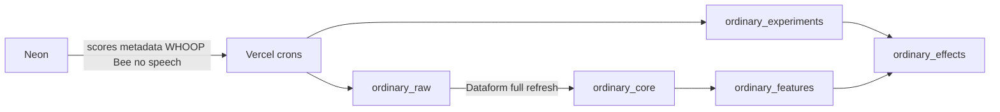

# Warehouse runbook

Neon is the app's source of truth. BigQuery in London (`europe-west2`, project `the-ordinary-512212`) is for analysis. The app does not read BigQuery to render a page. Speech does not enter BigQuery. The scorer's `detail` metric is stored as `metric_detail`, because `detail` is on the speech-key denylist.

## How data moves



London times:

| Time | Job |
| --- | --- |
| 02:30 | `/api/cron/whoop-sync` reads the last 3 days of WHOOP for consented, connected members |
| 03:00 | `/api/cron/warehouse-export` exports scores, consents, confounders, and Bee metadata |
| 04:00 | GitHub Actions runs Dataform. The synthetic effect test runs before production effects |
| 05:00 | `/api/cron/experiments-decide` writes today's decision for each active experiment |

Vercel sends `Authorization: Bearer $CRON_SECRET`. Hobby and Pro both allow these once-a-day schedules (100 cron jobs per project), so the three routes stay separate.

## Local landing with Kedro

Kedro in [`warehouse/kedro`](../../warehouse/kedro) is the local catalog. It does not replace these crons or Dataform, and it has no schedule of its own.

`kedro run` from that directory uses the `dev` environment. It reads Neon for a status row (health consent, whether WHOOP is connected, whether a Bee account token exists) and writes gitignored parquet under `warehouse/kedro/data/`. It does not write BigQuery. WHOOP records and Bee items are not stored in Neon, so those local frames are empty until you sample London.

Landing your rows in `ordinary_raw` does not need a Vercel deploy. It does need Application Default Credentials that can impersonate `ordinary-vercel-writer`, `DATABASE_URL`, `USER1_EMAIL`, and the production `MEMBER_KEY_SECRET`. From `warehouse/kedro`:

```bash
kedro run --env=prod --pipelines=land_user1
kedro run --env=prod --pipelines=sample_raw
```

`land_user1` syncs that member's WHOOP window (30 days unless `days` is changed) and then runs the same export the 03:00 cron runs. `sample_raw` reads at most 100 rows from each WHOOP and Bee raw table, leaves out the payload column, and writes `data/08_reporting/`. A plain `kedro run` cannot select the prod catalog.

The scheduled path still needs this branch deployed. Production crons run on theordinary.club, and the 04:00 Dataform job runs from `main`. After raw rows exist, Dataform can also be run once locally by impersonating `ordinary-dataform` if you want feature tables before that schedule exists.

## Re-run a night

```bash
curl -H "Authorization: Bearer $CRON_SECRET" "https://theordinary.club/api/cron/whoop-sync?days=30"
curl -H "Authorization: Bearer $CRON_SECRET" "https://theordinary.club/api/cron/warehouse-export?days=30"
curl -H "Authorization: Bearer $CRON_SECRET" "https://theordinary.club/api/cron/experiments-decide"
```

`days` is capped at 30. Then run the Warehouse workflow from GitHub (`workflow_dispatch`). The workflow runs the spine, then `effects_test`, and only then production effects. A failed synthetic assertion stops the effect tables from refreshing.

`pnpm warehouse:ensure` creates any missing raw and experiment tables. `pnpm warehouse:status` prints one line per check.

## WHOOP webhook

After this is deployed, register `https://theordinary.club/api/whoop/webhook` in the WHOOP developer dashboard and use the v2 webhook model.

WHOOP signs `X-WHOOP-Signature-Timestamp` plus the raw body with the app client secret, HMAC-SHA256, base64. v2 recovery events carry the sleep UUID, not the cycle id. The handler loads the sleep, reads `cycle_id`, then loads `GET /v2/cycle/{cycleId}/recovery`. Recovery rows are stored under `cycle_id`. Sleep and workout rows use their own ids. Delete events write a tombstone (`deleted = true`, `payload = null`). WHOOP does not send cycle webhooks. Cycles arrive from the collection sync. The collection page size is 25, which is the documented maximum, and pages follow `next_token`.

## Bee metadata

Bee's CLI documents `limit` and `cursor` for conversations and journals. It does not document a start/end filter on `GET /v1/conversations`, `GET /v1/journals`, or `GET /v1/daily`. The export pages with `limit=25` until the cursor ends or the page is older than the window. The fields this app already reads do not include an end time, so `duration_s` and `bee.conversation_minutes` stay null unless `end_time` is present. Summaries are not stored. Items tagged `Check-in from The Ordinary` are flagged `is_ordinary_echo` and dropped from features. The export uses the member's saved Bee token only. It does not fall back to the local machine proxy.

## First experiment

`experiments/first-experiment.json` is a draft. `hypothesis` and the treatment instruction are `TODO`, so `pnpm experiments:activate first-experiment` refuses.

When you are ready:

1. Replace both `TODO` values. Keep `whoop.hrv_rmssd_ms.dev` at `offset_days: 1` unless you have a reason to change it. Offset 0 is the decision date. Offset 1 is the next morning, because sleep and recovery are dated to the morning they describe.
2. Run `pnpm experiments:activate first-experiment`. It also refuses unless every outcome exists in `feature_registry` and the primary feature has at least 14 non-null days.
3. Follow the Home card for at least 42 days. 42 days is the shortest run. 70 is the longest this config allows. With one member and 42 to 70 days, only a fairly large effect, around 0.8 standard deviations, is detectable. A smaller effect can be real and still sit inside the interval.

The card shows the treatment instruction, or "Nothing extra today, carry on as normal." Done and Skipped are stored. Nothing is emailed. Nothing renders when no experiment is active.

## Hackathon MVP

`experiments/barbara-dry-run.json` is a loose v2 monitoring file for one test member. Activate it with `--enrol-me --start` set 30 days back so the study window covers data already in London. `pnpm partner:import` loads synthetic partner rows into `ordinary_raw.partner_measures` (`is_synthetic = true`). Dataform tag `studies` builds `ordinary_core.study_enrolments` and `ordinary_effects.study_frame_long`. `pnpm demo:snapshot` copies a firewall-checked payload into Neon `demo_snapshots`. `/demo` reads that snapshot. It does not query BigQuery. The Spotify file in `experiments/concepts/` is never activated.

Rehearsal order and the stage script: [`HACKATHON-DEMO.md`](HACKATHON-DEMO.md).

## Reading results

Saved queries are in [`results.sql`](results.sql).

`beta` is the intent-to-treat effect on the outcome's scale, after the sign is flipped so a positive number means better. `p025` and `p975` are the 2.5 and 97.5 percentiles of a 2,000-draw block bootstrap. `prob_positive` is the share of those draws above zero. `status = insufficient_data` means fewer than 14 outcomes. Observational rows have `not_causal = true`. They are associations, not causes.

## End an experiment and start version 2

```bash
pnpm experiments:end first-experiment
```

That marks the active version ended and closes the enrolment. Copy the JSON, increment `version`, and activate the new version. Do not edit an active config.

## Erase a member

Withdrawing health consent or deleting the account computes `member_key` first, then deletes that key from `ordinary_raw` and `ordinary_experiments`. A warehouse error is stored on the `erasure` stream and retried on the next export. It does not block the member. While consent is withdrawn, the export skips them. Granting consent again sets a re-export flag and the next run sends their history. Derived tables are full refreshes, so the member disappears from core, features, and effects on the next Dataform run.

## What is not built

Email nudges, rewards, pooling across members beyond within-member centring, and Bee text features. Scoring is unchanged. TimesFM 3.0 and `AI.DETECT_ANOMALIES` are omitted because they are not confirmed in `europe-west2`. `ordinary_effects.counterfactual` records `unavailable_in_region` and does not query another region.

## Bootstrap still needs a person

`warehouse/bootstrap.sh` needs `gcloud auth login`, `gcloud auth application-default login`, and billing on `the-ordinary-512212`. The live Vercel team is `440hz` and the project is `theordinary` (`https://vercel.com/440hz/theordinary`, domain `theordinary.club`). OIDC issuer mode on that team is Team (`https://oidc.vercel.com/440hz`). Dataset roles are written on the dataset access list, because dataset IAM policy bindings are not allowlisted on this project. The script never creates a service-account key. The £25 budget is created only with `CONFIRM_BUDGET=25`.
